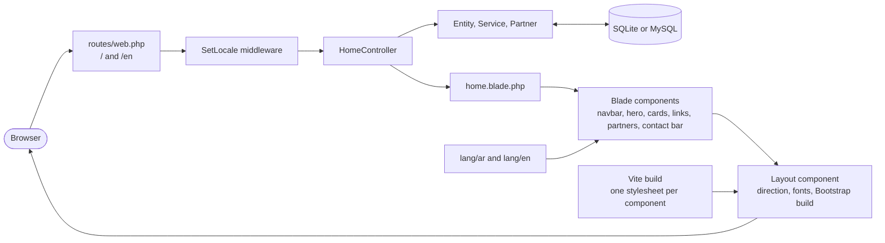

<h1 align="center">Amrtm Business Homepage</h1>

<p align="center">A Laravel rebuild of the Amrtm business platform homepage, in Arabic and English, measured against the live site.</p>

<p align="center">
<a href="https://github.com/Asjadfaroq/amrtm-business-homepage/actions/workflows/ci.yml"></a>


</p>

This is my take-home task for the Full-Stack Developer role at Amrtm. The brief was to rebuild the homepage of [business.amrtm.com.sa](https://business.amrtm.com.sa) in my own code. The page is a single screen: a navbar, a hero with a rotating background, five entity cards, six professional service links, a partners marquee and a contact bar.

It runs on Laravel 13 with Blade components, Bootstrap 5.3 in its RTL and LTR builds, and Vite. The cards, service links and partners come from the database through Eloquent models. Layout, spacing, colours and typography follow the live site; the code, structure and class names are my own.

**Live demo:** [amrtm-business-homepage.onrender.com](https://amrtm-business-homepage.onrender.com)

## Highlights

- At 1920 by 945 in Arabic, 28 measured elements (navbar, hero, cards, service links, partners strip, contact bar) sit within 0.05 px of the live site in position and size.
- At nine widths from 360 to 1440 px, the measured elements are within 2 px of the live site, except where the live site itself breaks (see [Differences](#differences-from-the-live-site)).
- Two locales with real direction switching: `/` is Arabic and RTL, `/en` is English and LTR, each loading the matching Bootstrap build.
- Cards, service links and partners are database records with an Arabic and an English name, seeded by migrations and seeders.
- Fonts and icon fonts are preloaded and the logo has set dimensions, so the navbar does not shift while the page loads.
- Every push runs Pint, the feature tests and the asset build on GitHub Actions.

## Architecture



## How a request flows

1. `routes/web.php` maps `/` and `/en` to `HomeController`, each with the `locale` middleware and its language.
2. `SetLocale` sets the application locale for that request.
3. `HomeController` loads the entities, services and partners in their sort order.
4. `home.blade.php` composes the page from Blade components and passes each record to its card or link.
5. The `HasLocalizedName` trait returns `name_ar` or `name_en` for the current locale, so the views only ask for `name`.
6. The `Layout` component works out the direction, preloads the fonts for that locale and loads the RTL or LTR Bootstrap build with the page stylesheet.
7. Headings, navigation and button labels come from `lang/ar/home.php` and `lang/en/home.php`.
8. The four navigation links resolve through one constrained route to a placeholder page, in both locales.

## Matching the live site

I measured the live site and this page in Chrome with `getBoundingClientRect`, comparing the position and size of the same elements at each width.

| Width | Result |
|---|---|
| 1920 | 28 of 28 elements within 0.05 px |
| 1440, 1366, 1200 | all measured elements within 2 px |
| 1024 | within 2 px, except the navbar actions |
| 992, 768, 600, 390, 360 | all measured elements within 2 px at the top of the page |

The measurements are of the Arabic page. The typeface (Cairo, with Inter for English), the icon sets (Font Awesome and Tabler), the colours, the shadows and the hover states are the same as the live site.

## Responsive behaviour

| Width | Navbar | Cards | Service links |
|---|---|---|---|
| 1200 and up | links and all three actions | 5 in a row | 6 in a row |
| 1024 to 1199 | links, provider button hidden | 5 in a row | 6 in a row |
| 993 to 1023 | menu button | 5 in a row | 6 in a row |
| 769 to 992 | menu button, hero stacks | 4 and 1 | 3 in a row |
| 641 to 768 | menu button | 3 and 2 | 3 in a row |
| 481 to 640 | menu button, icon-only actions | 3 and 2 | 2 in a row |
| 480 and below | menu button, icon-only actions | 2, 2 and 1 | 2 in a row |

## Differences from the live site

Where the live site has a defect, this page fixes it instead of copying it.

- **English locale.** The live site leaves several labels in Arabic when switched to English, keeps the heading right-aligned and puts the contracts button on the far left. Here the English page is fully translated and the hero mirrors for LTR.
- **Navbar at 1024 px.** On the live site the provider button runs 50 px off the screen. Here it is hidden below 1200 px.
- **End of scroll on small screens.** On the live site the last 80 px of the service links sit behind the partners strip. Here the scroll area ends above it.
- **Inner pages.** The navigation links open simple placeholder pages to show routing. Cards and buttons point to `#`.
- **Hero video.** The video card is visual only and does not open a player.

## Try it

You need PHP 8.3 with the `sqlite3`, `mbstring`, `xml` and `curl` extensions, [Composer](https://getcomposer.org/download/) and Node.js 20 or newer.

```bash
git clone https://github.com/Asjadfaroq/amrtm-business-homepage.git
cd amrtm-business-homepage
composer install && npm install
cp .env.example .env && php artisan key:generate
touch database/database.sqlite && php artisan migrate --seed
npm run build
php artisan serve
```

Open http://localhost:8000 for Arabic and http://localhost:8000/en for English. These steps were run on a clean clone.

To use MySQL, set `DB_CONNECTION=mysql` and the `DB_HOST`, `DB_DATABASE`, `DB_USERNAME` and `DB_PASSWORD` values in `.env`, then run `php artisan migrate --seed` again. Nothing else changes.

```bash
php artisan test          # feature tests
vendor/bin/pint --test    # code style
```

The same app runs in a container:

```bash
docker build -t amrtm-home .
docker run --rm -p 8080:10000 -e APP_KEY=$(php artisan key:generate --show) amrtm-home
```

## Project structure

```
app/
  Http/Controllers/        HomeController, PageController
  Http/Middleware/         SetLocale
  Models/                  Entity, Service, Partner
  Models/Concerns/         HasLocalizedName
  View/Components/         Layout
config/platform.php        locales, navigation, pages, fonts, hero slides, contact numbers
database/migrations/       table definitions
database/seeders/          homepage content
lang/ar, lang/en           interface text
resources/css/             base.css and one stylesheet per component
resources/js/              hero-slider.js
resources/views/           home, page and the Blade components
tests/Feature/             HomePageTest
Dockerfile                 asset build stage and PHP runtime
.github/workflows/ci.yml   lint, tests and build
```

## CI

On every push and pull request, GitHub Actions installs the PHP and Node dependencies, builds the assets, checks the code style with Pint and runs the feature tests. The tests cover both locales, the direction of each page, the seeded content, the placeholder pages and the 404 for unknown paths.

## Deployment

The demo runs from the `Dockerfile` on a free Render instance. The first stage builds the assets with Node. The second installs the PHP dependencies and, on start, creates the SQLite file, runs the migrations and seeders and starts the server. The filesystem there is not persistent, so the content is seeded again on every start.

## Limitations and what I would do next

- The container serves the app with PHP's built-in server, which sends no cache headers for static files. Next: FrankenPHP or nginx with PHP-FPM, with long-lived caching for the hashed assets.
- The whole Bootstrap stylesheet and every Tabler icon subset are bundled, although the page uses a small part of each. Next: import only the Bootstrap parts in use and ship the five Tabler icons as inline SVG.
- The match with the live site was measured by hand in one browser. Next: a Playwright job in CI that compares element positions at each breakpoint.
- The tests work at the HTTP level only. They do not cover the slider, the mobile menu or the layout.
- The English page is my own translation and layout, so it has no reference to be measured against.

## Notice

The Amrtm name, logo and images belong to Amrtm and are used here only for this assessment.

---

<p align="center">Built by Asjiad Farooq</p>

<p align="center">
<a href="https://github.com/Asjadfaroq"></a>
<a href="https://www.linkedin.com/in/asjadfarooqconnect"></a>
</p>
